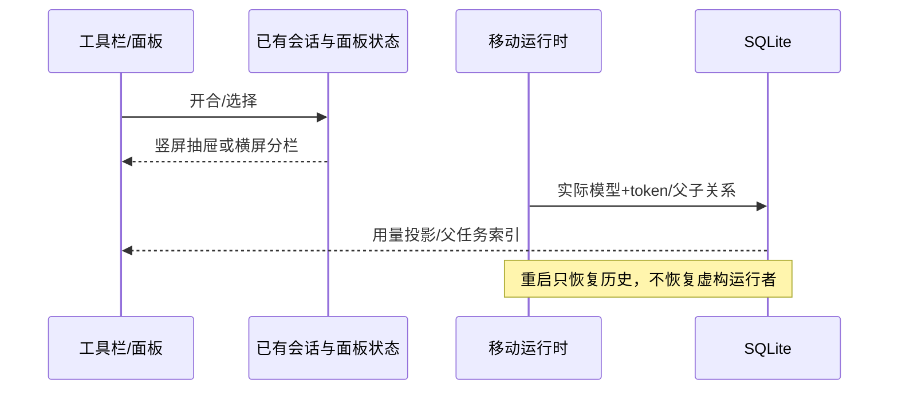

# 移动端0.9.0交互与状态

- 面板开合唯一属主为现有sidePaneState。移动宿主竖屏使用右侧抽屉和遮罩，主对话保持全宽；横屏恢复可调整分栏。关闭不销毁子代理时间线，隐藏时暂停其React副作用，避免重复装配和后台渲染。
- 子代理属于父任务的子会话，只在父任务时间线/右侧目录展示，不进入全局任务列表；旧版本误入的子会话也应迁移隐藏。
- 索引查询通过可选excludeTaskIdPrefix在SQL分页前排除移动子会话；计数和分页不得被隐藏子会话占满。Android返回键优先关闭可见的右抽屉，再处理左侧栏。
- 重启后没有真实运行者的任务统一显示中断，不把持久化running当作当前运行事实。
- 应用用量按实际请求模型记录，不从会话当前配置猜测历史。缺少归属证据的旧轮次标为未知；同一会话更换模型后统计必须分开。
- 统计页竖屏摘要采用紧凑网格，图表、切换和触控目标不得挤出视口。
- 桌面兼容版本为移动宿主单独管理的设置，经平台接口读取/修改；不覆盖真实APK版本，服务端资格判断不在客户端伪造。

